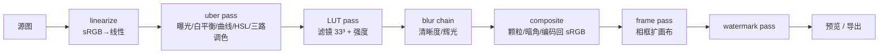

# 潜影 / LATENT · 技术与产品计划

**名字**：潜影（latent image）——曝光之后、显影之前那张看不见的像。非破坏性编辑栈正是这个东西：所有参数只是潜影，导出那一刻才成为照片。工程标识 `latent`，窗口标题「潜影」。

对标：iPhone 摄影风格 / 华为「色卡」+ 滤镜 + 相框 + 水印。非破坏性、GPU 实时、一套管线同时服务预览与导出。
技术栈已定：**React 19 + TypeScript + Vite + Tauri 2**，动效 GSAP，视觉按 `design-taste-frontend`（tasteskill v2，app-screen 分支）。

**进度**：M0 已完成并通过验证（§11）。

```
npm run tauri dev     # 桌面窗口（自动起 Vite）
npm run dev           # 只在浏览器里跑渲染器
npm test              # 黄金图门禁：恒等、朝向、脏标记调度、软渲染检测
```

---

## 1. 平台与技术选型

| 层 | 选择 | 理由 |
|---|---|---|
| 外壳 | Tauri 2（WebView2 / WKWebView） | 安装包 ~5MB，Rust 侧可直接写文件、读 EXIF、后续接原生解码 |
| 渲染 | WebGL2 + 自研 `Renderer` | 一条管线同时出预览与 6000px 导出；不依赖 CSS filter（无法 16F、无法 LUT、无法精确） |
| UI | React 19 + Zustand + immer | 编辑栈需要不可变快照做撤销；Zustand 的 `subscribe` 可直接驱动「脏标记」重绘 |
| 动效 | GSAP 3 + `@gsap/react` | 见 §8；**不用 ScrollTrigger**（编辑器无滚动，只有固定视口） |
| 字体/图标 | Inter（UI）；题注用 2–3 款打包字体 | 图标用 1.5px 描边单色集，不引图标库 |

**Tauri 必做的三条风险控制**

1. 启动时读 `WEBGL_debug_renderer_info`。WebView2 在驱动被 blocklist 时会静默落到 SwiftShader（CPU 软渲染），表现为「打开就卡」。检测到 `SwiftShader|llvmpipe|Microsoft Basic` 直接提示并禁用 GPU 预览。
2. WebGL2 上下文丢失（`webglcontextlost`）必须恢复：文档是唯一真相，重建纹理后重放 ops。
3. 大图走 Rust 侧解码/写盘（`image` crate + `fs` plugin），不经 base64 过 IPC——12MP 走 base64 会多占 ~50MB 峰值并卡住 UI 线程。

---

## 2. 视觉方向（tasteskill 抽签结果）

`draw.mjs --app --kind builder --theme dark` 出签：**`true-black-flat`**，seed `456563051`，存档 `D:/Project/.taste-skill/direction.json`。

**保留的 move**：层级只靠明度差，卡片无边框无阴影；导航激活态只是文字由 `#bbb` → `#fff`；主按钮靠反色（白底黑字 36px pill）。

**两处已记录的修改（原因可陈述）**

| 改 | 从 | 到 | 理由 |
|---|---|---|---|
| 地色 | `#000` 纯黑 | 外壳 `#0b0b0b`，照片台面 `#161616` | 纯黑会让暗部误判（视网膜适应把画面读得比实际更亮），且黑图与背景无边界。台面比外壳**亮一档**，照片边界永远可辨。 |
| 强调色 | 莱姆 `#c6f24e` | 无 | 调色工具里，界面任何饱和色都会通过同时对比污染对照片的读色。色相只允许存在于画布内：高光裁切红、暗部裁切蓝（Lightroom 惯例），以及照片自身。 |

这一条是产品立论，不是审美偏好：**界面不许有颜色，颜色是作品的事。**

### Tokens

```css
:root {
  --ground:#0b0b0b;      /* 外壳：栏、面板底 */
  --stage:#161616;       /* 照片台面：均匀，无渐变、无暗角 */
  --raised:#1d1d1d;      /* 浮起：下拉、弹层 */
  --hairline:#232323;    /* 仅用于分组，不用来包卡片 */
  --text:#fff; --muted:#b4b4b4; --faint:#949494;
  --primary:#fff; --primary-ink:#000;
  --clip-hi:#e5484d; --clip-lo:#3b82f6;   /* 只出现在画布内 */
  --radius-panel:14px; --radius-control:999px;
  --fs-title:20px; --fs-section:15px; --fs-body:14px; --fs-small:12px;
}
```

### 这张脸（skill 要求「只有这个产品有的一个元素」）

**装裱台（mount board）**：相框与题注是同一个装置——照片落在卡纸上，卡纸下缘留出题注带，标题/作者用正文字排。它同时是相框的默认形态和水印的优雅解法（把角标 logo 换成画廊标签式的署名）。它出现在首屏，一眼认得出是「装裱」而不是「贴图」。

### 版式

- 顶栏 44px：退出、文件名（16/600）、右侧 16px 图标组 + 反色主按钮「导出」。
- 左栏 232px：**色卡网格**（2 列、gap 10px、缩略图 1:1，选中态只有 1px 白色内描边），下方是调色滑块组。
- 右栏 260px：滤镜、相框、水印三个 tab。
- 台面居中，照片四周留白 ≥48px；不铺渐变底、不铺棋盘格（棋盘格只在 PNG 透明图时出现）。
- 顶栏必须承载真实内容（文件名、尺寸、缩放比），不留空。

---

## 3. 核心架构：非破坏性编辑栈

文档 = 原图 + 有序 ops + 裁剪几何。渲染 = 重放。撤销 = immer patches 快照。**参数永不写回像素。**



| Pass | 色彩空间 | 格式 | 内容 |
|---|---|---|---|
| 0 | sRGB→linear | RGBA8→**RGBA16F** | EXIF 方向校正；ICC 假定 sRGB |
| 1 uber | linear | RGBA16F | 曝光、对比、高/阴影/白/黑、色温色调、鲜艳度饱和度；RGB + 单通道曲线；8 色带 HSL；三路调色 |
| 2 LUT | linear | RGBA16F | 33³ 3D 纹理，`mix(src, lut(src), t)`；`t=0` 跳过整 pass |
| 3 blur | linear | RGBA16F | 分离高斯 + mip 降采样链，供清晰度/辉光/柔焦复用 |
| 4 composite | linear→sRGB | RGBA8 | 颗粒（哈希噪声，屏幕空间固定）、暗角、dither ±1/255 |
| 5 frame | sRGB | RGBA8 | 扩画布 + 卡纸/边框/9-slice 素材 + 题注 |
| 6 watermark | sRGB | RGBA8 | 文字/图片合成，锚点相对**照片矩形** |

中间缓冲必须 RGBA16F：8 位链路做完曲线 + HSL 必出条带。**预览 develop 在显示分辨率**（照片按 45% 显示就只算 45% 的像素），导出与缩略图各自按目标尺寸另建 target；源纹理带 mipmap，缩小取样不闪烁。

**朝向约定（已用黄金图钉死）**：所有离屏 target 的 row 0 都是图像顶行，与解码纹理同向；只有最后画到 canvas 的那一次才翻 v（`quad-screen.vert`）。两处都翻 = 上下颠倒但颜色全对——这是 M0 实际踩到的坑，颜色检查永远发现不了，只有不对称四象限测试能。

**两个色彩空间，各管一段**：白平衡/曝光/鲜艳度/饱和度在线性光；影调、曲线、HSL、分级在显示空间（sRGB 编码值）。原因不是习惯——曲线和对比的支点（0.5）是按眼睛定的，放进线性光里曲线会全部挤在暗部；把影调段整体搬到显示空间之后，曲线也能直接读 LUT，一次取样就是「单通道曲线 ∘ 主曲线」。

---

## 4. 色卡

色卡 = 参数快照，不含图像。缩略图从**用户当前照片**降采样到 128px、批量渲染进 atlas，缓存键 `(imageId, presetHash, 128)`——用户看到的是自己照片变成各种风格，这是「摄影风格网格」的全部观感来源。

**强度滑块在参数空间插值**：逐参数 `lerp(base, preset, t)`，曲线在控制点插值后重建。输出像素混合会让高光发灰、肤色失色。

首批内置 12–16 个，每个附一张固定参考图兜底首帧。预设可导入导出 JSON；`.cube` 只承载滤镜。

---

## 5. 滤镜

1. **3D LUT（主力）**：`.cube` → 33³ RGBA8 3D 纹理（硬件三线性），强度统一由 `intensity` 控制。
2. **程序化增强**：颗粒、暗角、辉光/柔光、色差、胶片晕染，全部复用已有 pass 与模糊链，不新增管线。
3. 预留局部调整：遮罩纹理作为 uber pass 的一个输入，架构上留口即可。

---

## 6. 相框（新增）

相框不是贴图，它**改变输出画布尺寸**——这个决定必须现在做，后补要重写导出、预览缩放和水印锚定。

```ts
type FrameParams = {
  kind: 'none' | 'mat' | 'border' | 'asset';
  insets: { t: number; r: number; b: number; l: number }; // 相对照片短边的百分比，可不等（宝丽来下缘更厚）
  color: string;               // 卡纸色
  radius: number;              // 卡纸圆角
  stroke?: { width: number; color: string };
  assetRef?: string;           // 9-slice 素材：PNG + 切片元数据 JSON
  caption?: { text: string; font: string; size: number; color: string; align: 'l'|'c'|'r' };
};
```

规则：

- **输出尺寸 = 照片尺寸 + insets**，所有 insets 由**照片短边**推导。预览与 6000px 导出因此天然一致。
- 三类实现：几何卡纸/边框用 shader 直接画（任意 DPI 都锐利，零纹理内存）；素材框用 **9-slice**（四角不拉伸，边条按比例缩放），切片元数据随素材存 JSON，缩放系数 = 目标短边 / 设计短边。
- 圆角与内描边在卡纸上做，照片本身不动；宝丽来下缘加厚靠 `insets.b` 单独放大。
- 题注带（caption）只在下缘高度足够时可用，按照片短边归一排版；它是水印的「优雅形态」，不是第二套系统。
- 相框在编码回 sRGB 之后绘制，因此卡纸色所见即所得，不被 gamma 弯曲。

---

## 7. 水印

```ts
type WatermarkParams = {
  kind: 'text' | 'image';
  text?: string; font?: { family: string; weight: number; size: number };
  anchor: 'tl'|'t'|'tr'|'l'|'c'|'r'|'bl'|'b'|'br';
  offset: { x: number; y: number };   // 相对短边百分比
  scale: number; rotation: number; opacity: number;
  blend: 'normal'|'multiply'|'screen';
  tile: boolean; color?: string;
  target: 'photo' | 'frame';          // 落在照片上，还是落在卡纸题注带
};
```

- 文字用 `OffscreenCanvas.fillText` 栅格化 → 纹理（免费获得字体族/字重/字距），锚点按照片矩形计算。
- 一切尺寸按短边归一，硬性规则 + 黄金图验证。
- 平铺只栅格化一格，UV 取模重复，不生成超大纹理。

---

## 8. 动效系统（GSAP）

**定位**：动效只做三件事——**操作反馈、状态切换、入场编排**。它不参与像素渲染。

### 硬性工程约束

1. **画布永不被 CSS/GSAP transform**。缩放平移只改渲染器的相机矩阵并重绘。用 CSS `scale` 画布 = 二次采样 = 变糊，且会与 GPU 管线打架。
2. **不用 ScrollTrigger**。编辑器是固定视口，不存在滚动叙事；装了就是死代码。
3. 所有 GSAP 调用走 `useGSAP({ scope })`，`gsap.registerPlugin(useGSAP)` 一次；事件回调包 `contextSafe`。
4. **`gsap.ticker` 是唯一的时钟**：`gsap.ticker.add(renderIfDirty)`，避免 rAF 双循环。

### 有意思的一处用法

点击色卡时 **tween 一个普通参数对象**，`onUpdate → markDirty → GPU 重绘`。照片在 380ms 内「冲洗」到目标风格，而不是硬切。这是 GSAP 在这里唯一不可替代的价值——它驱动的是**参数**，渲染仍然是每帧一次。

### 曲线与时长（skill tokens）

```css
--ease-out:cubic-bezier(.22,1,.36,1);      /* <600ms 的一切 */
--ease-expo:cubic-bezier(.16,1,.3,1);      /* ≥800ms 的揭示 */
--ease-in-out:cubic-bezier(.76,0,.24,1);   /* 抽屉、面板、遮罩擦除 */
--t-press:140ms; --t-hover:180ms; --t-ui:240ms; --t-panel:420ms; --t-apply:380ms;
```

| 场景 | 动效 | 时长/曲线 |
|---|---|---|
| 按钮按下 | `scale(.97)` | 140ms out |
| 面板切换（色卡/滤镜/相框/水印） | 位移 16px + 透明度，**不动宽度** | 240ms out |
| 色卡应用 | 参数 tween | 380ms expo |
| 相框切换 | 画布尺寸变化用两帧布局（先量后动），卡纸色 `backgroundColor` 过渡 | 240ms ease |
| 导出抽屉 | 从右侧滑入 | 420ms in-out |
| 首屏入场 | 顶栏 → 左右栏 → 台面，交错 70ms，位移 12px | 总时长 ≤1.2s，settled |
| 前后对比 | 指针拖动 `clip-path`，**无缓动**（跟手 ≥ 线性） | 0ms |
| 禁令 | 弹跳/回弹、无限循环装饰（呼吸点、流光）、玻璃模糊、渐变 | — |

`prefers-reduced-motion: reduce` → 全部即时到位，内容不隐藏。

---

## 9. 导出

- 全分辨率离屏渲染，`MAX_TEXTURE_SIZE` 分块拼接（≥8192 不分块）。
- `readPixels` → `ImageData` → `OffscreenCanvas.convertToBlob`；PNG / JPEG / WebP。
- 输出尺寸由相框决定，文件名带尺寸；保留 EXIF 方向，UI 标明「sRGB 输出」。
- 导出前重放全部 ops，绝不复用预览缓存。

---

## 10. 目录结构

```
src-tauri/            Rust：文件、EXIF、解码
src/
  core/      doc.ts presets.ts history.ts frames.ts
  gl/        renderer.ts camera.ts texture.ts fbo.ts
             passes/{uber,lut,blur,composite,frame,watermark}.ts
             shaders/*.glsl
  ui/        App.tsx Stage.tsx panels/{Presets,Filters,Frames,Watermark}.tsx
             primitives/{Slider,Panel,Switch}.tsx
             motion/  tokens.ts useEnter.ts usePresetTween.ts
  export/    exporter.ts
tests/golden/
```

---

## 11. 里程碑

| 阶段 | 交付 | 验收 |
|---|---|---|
| **M0** 骨架 ✅ | Tauri + Vite；`Renderer` 两段式管线（linearize → encode）；解码/打开/拖入/粘贴；GSAP ticker 接脏重绘；SwiftShader 检测 | 已验：往返恒等 **maxΔ=0**（256²、1920×1080，以及 Tauri 窗口内 96×64）；朝向四象限正确；**60.2fps** 持续渲染且每帧恰好一次绘制；Tauri 窗口实测 `ANGLE (AMD, D3D11)` + `EXT_color_buffer_float`，canvas 2522×1329；`--use-angle=swiftshader` 下 `caps.software=true` 且顶栏提示出现 |
| **M1** 外壳与设计门禁 ◐ | 顶栏 + 右栏（调色）+ 装裱板空态；设计门禁两轮走完；**左栏随 M3 色卡一起落**（先建空栏就是占位） | `lint` 0 FAIL 0 WARN；`inspect --app` 0 FAIL @1440/768/390；装裱板 3:2、手机 4:5 |
| **M2** 基础调色 ✅ | uber pass 全参数（白平衡→曝光→影调→对比→鲜艳度→饱和，全在线性光）；`core/adjust.ts` 参数模型；右栏 10 个滑块、双击归零、重置；脏标记合并到单帧 | 已验：3840×2400 图 **4.87ms/帧**（含 readback 同步）；50 次滑块事件 → **恰好 1 次 develop**；0 参数逐字节不变；+1EV 使线性光翻倍（128→176±1，200→255）；重置后逐字节还原 |
| **M3** 色卡 ✅ | 12 内置色卡 + 自存/删除/导入导出（localStorage + 校验过的 JSON）；缩略图用当前照片渲染、4:3 中心裁切；强度在参数空间插值；点击 tween 380ms 带动滑块 | 已验：12 张缩略图 **13ms 渲染 + 20ms 编码**；强度 0 逐字节等于原图、强度 1 逐字节等于预设；自存色卡刷新后仍在；坏文件报错不崩 |
| **M4** 曲线 + HSL + 分级 ✅ | 四点曲线（RGB + 单通道，Fritsch–Carlson 单调三次，烘成 256×1 RGBA16F LUT，一次取样完成两级）；8 色带 HSL（角度加权归一、近灰淡出）；三路分级（零亮度色度偏移，不抬亮度）；面板拆成 调色/曲线/HSL/分级 四个 tab | 已验：单通道曲线只动该通道（其余两通道逐像素差 = 0）；红带去饱和只动红、灰与蓝完全不动；分级让亮部转暖暗部转青；3840×2400 全链路 **0.63ms/帧** |
| **M4.5** 撤销/重做 ✅（插队） | 不可变快照历史：结构共享、同控件 700ms 内合并成一步、上限 100；tween 期间走 preview 不进历史；顶栏之外放在面板头（撤销/重做/重置）+ Ctrl/⌘Z、Shift+Z、Ctrl+Y | 已验：24 次拖动 = 1 步且一次撤销逐字节还原；色卡 tween = 1 步；重做精确回到拖动后的状态 |
| **M5** 滤镜 ✅ | `.cube` 解析（3D 与 1D、TITLE、DOMAIN，逐行校验）→ 33³ **RGBA16F** 3D 纹理；编码 pass 里做 LUT/暗角/颗粒；3 张程序生成的滤镜（棕褐/漂白/夜幕）+ 导入 .cube；强度滑块 | 已验：恒等表 maxΔ ≤ 1；反相表逐像素 = 255−原值；强度 0.5 落在中点；颗粒两次渲染完全一致、分辨率无关；暗角角落比中心暗 20+ 级 |
| **M5.5** 模糊链 ✅（插队） | 降采样 + 可分离 9-tap 高斯，半分辨率与四分之一分辨率各一条；同一条链供**清晰度 / 辉光 / 柔焦**；辉光**先阈值后模糊**（反了就没有外溢）；三项全零时整条链跳过 | 已验：清晰度让边缘暗侧更暗亮侧更亮；辉光让高光周围 10px 处的暗部亮 >3 级；柔焦把硬边拉向平均值且平面不动；全开 **1.75ms/帧**（1160×1070） |
| **M6** 相框 ✅ | 卡纸在编码 pass 里合成（颜色 / 四边不等留白 / 圆角），**输出尺寸 = 照片 + 留白**；留白按照片短边归一；四张预设（无 / 白卡 / 黑卡 / 宝丽来）；圆角外写 alpha 0，PNG 导出透明 | 已验：200×100 + 0.1 留白 → **220×120**；照片落在 (10,10)；不等留白 0.2/0.05/0.05/0.3 → **225×135**；圆角外 alpha=0、中心仍是照片；无框时逐字节等于原图 |
| **M7** 水印 ✅ | 文字（Canvas2D 栅格化 → 纹理）与图片（PNG 导入）；9 个锚点 + 双向偏移；大小/不透明度/角度/平铺；**可落在照片上，也可落在卡纸题注带**；尺寸一律按照片短边归一 | 已验：右下锚点落在 118..199 × 78..99；不透明度 0 逐字节等于原图；平铺覆盖面积 > 单枚 4 倍；落在卡纸时 y ≥ 照片下缘（题注带内） |
| **M7.5** 9-slice 素材框 ✅ | 边框纹理按九宫格取样（四角原尺寸、边条单向拉伸、中心透明）；示例素材用代码生成（奶油色纸边 + 深色细线 + 琥珀色角饰）；素材框强制四边等宽 | 已验：同一框套在 400×100 与 100×400 的图上，角饰在两种长宽比下都是 **≈9×9 的方块**（差 ≤2px），且两者尺寸一致——整张拉伸的实现会给出 ~48×2 的长条 |
| **M9** 相机 ✅ | 适应窗口 ↔ 100% 切换（顶栏百分比按钮）、滚轮以光标为锚缩放、拖动平移、双击切换；预览只 develop **可见区域**（），放大后不会整张重算 | 已验：400×200 图 2× 放大后标记宽度 ×2 且中心不动； 精确回到原尺寸；平移 120px 后标记移动 >100px、倍率不变 |
| **M8** 导出与打磨 ✅ |  全分辨率重跑整条链（含相框）→ PNG / JPEG / WebP + 画质；桌面走 Tauri 原生保存对话框（dialog + fs 插件），浏览器回落到下载；JPEG/WebP 把透明圆角压到白底 | 已验：UI 端到端 200×100 + 白卡 → PNG **文件头**读出 210×110；JPEG 魔数与文件名正确；9.2MP 导出 **119ms 渲染 + 272ms 编码**；`cargo check` 通过；**release 构建 4m49s 通过**，产物 7.8 MB，启动后 WebView2 起来、canvas 2522×1329、生产包内 `__grade` 为 undefined |

---

## 12. 测试

- **黄金图**：Playwright 无头渲染固定 256×256 输入（渐变/肤色/纯黑纯白/饱和色），逐像素比对，容差 ΔE<1（dither 允许 ±1/255）。
- 必测恒等：linearize↔encode 往返、强度 0、中性 LUT、相框 `kind:'none'` 时导出尺寸不变。
- 必测一致性：预览与导出同参、同缩放下的相框与水印位置。
- **设计门禁**：每个里程碑跑 `lint.mjs` 与 `inspect.mjs --app`，0 FAIL 才继续；截图逐张看过再交付。
- **夹具只有一份**：`tests/neutral.ts` 导出 `NEUTRAL_EDIT`，所有像素测试从这里起步。改 `EditState` 只改这一处——之前散在五个 spec 里，每加一个字段就有四个 spec 在渲染器里抛 TypeError。

---

## 13. 风险

| 风险 | 影响 | 对策 |
|---|---|---|
| 双重 sRGB 编码 | 全场画质错且「看着还行」 | 恒等往返黄金图做 CI 门禁；每个 pass 显式标注色彩空间 |
| WebView2 落软渲染 | 打开即卡，用户以为软件坏了 | 启动检测 + 明确提示 |
| 画布被 CSS 变换 | 模糊 + 缓存失效 | 相机矩阵唯一入口，代码评审点 |
| 安装包需要联网 | `bundle.active: false`，只能产出绿色 exe；NSIS/WiX 工具链要下载 | 发布前在网络可用时打开 bundle 并重跑 `tauri build` |
| 超大图不分块导出 | 超过 `MAX_TEXTURE_SIZE` 的合成尺寸会直接报错，而不是悄悄降质 | 分块会让模糊链在接缝处断开，宁可明确拒绝；上限写在错误信息里 |
| 相框改变画布尺寸 | 后补需重写导出/预览/水印 | M6 前先定 schema，M0 就把「输出尺寸由 ops 计算」写进 renderer 接口 |
| 中间缓冲显存 | 12MP 16F ≈ 96MB/张 | 预览按视口分辨率；导出分块 |
| 动效拖慢手感 | 相机类工具最致命 | 动效只碰 transform/opacity；拖拽路径零动画、单帧合并重绘 |
| 界面色彩污染 | 调色结果不可信 | 界面零色相（§2），裁切提示色只在画布内 |
| LUT 取样的半纹素偏移 | 恒等 .cube 也会偏 2–3 级，肉眼看不出，但「滤镜不改变无色图」这条就假了 | 取样坐标必须 `(c*(size-1)+0.5)/size`；与 M4 的曲线 LUT 同一个坑，已写成注释 |
| GSAP 会往被 tween 的对象上写 `_gsap` 缓存 | 展开运算符把它带进文档，`JSON.stringify` 遇到循环引用崩溃，且只在保存色卡时才暴露 | 参数一律经 `copyParams()` 逐键复制；序列化只写白名单键 |
