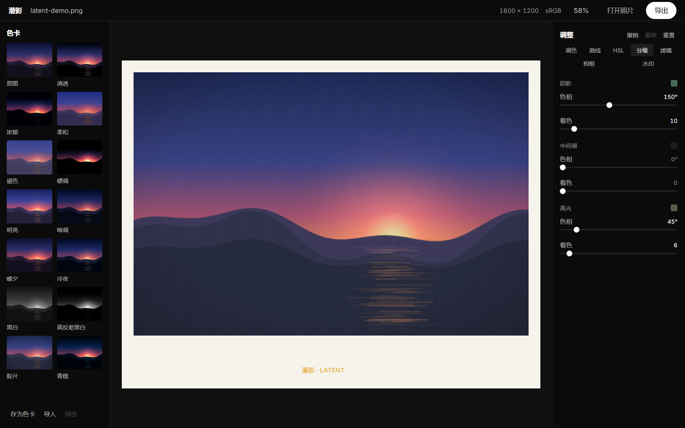
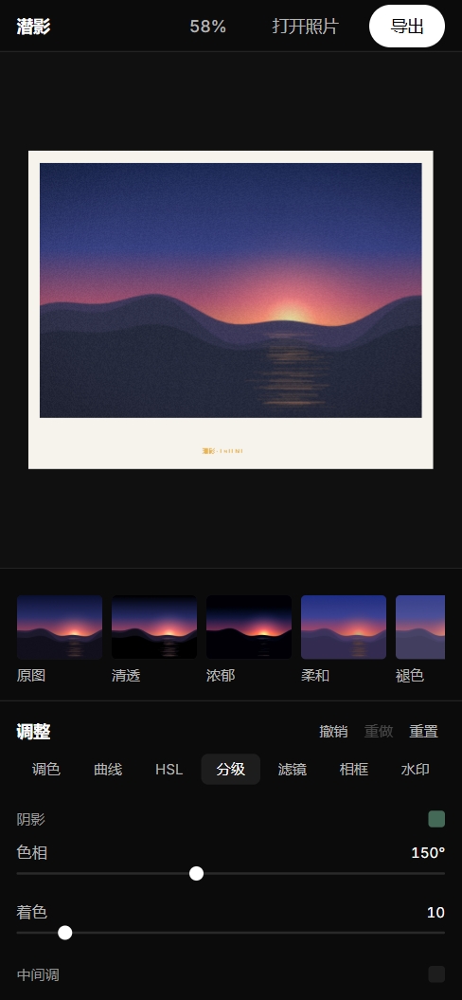
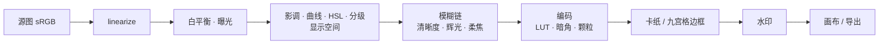

# 潜影 / LATENT

非破坏性图像调色编辑器。WebGL2 渲染管线 + React 界面 + Tauri 桌面外壳。

调色、曲线、HSL、三路分级、色卡、`.cube` 滤镜、清晰度/辉光/柔焦/颗粒/暗角、卡纸与九宫格边框、文字与图片水印、撤销重做、100% 查看、PNG/JPEG/WebP 导出。

> **一个前提**：界面里没有任何色相。调色工具周围的饱和色会通过同时对比污染你对照片的读色，所以颜色只允许存在于画布内——照片本身、以及裁切提示的红蓝。

```
npm install
npm run tauri dev     # 桌面窗口（自动起 Vite）
npm run dev           # 只跑渲染器，浏览器里开
npm test              # 像素级测试
```

## 界面



左栏是色卡——每一格都是**当前这张照片本身**变成那种调子的样子，不是素材带。中间是装裱与题注（水印可以落在卡纸的题注带上）。右栏是参数面板，分 调色 / 曲线 / HSL / 分级 / 滤镜 / 相框 / 水印 七页。



手机上色卡变成横条、面板落到下方，顶栏只留名字、缩放和两个动作。

> 截图里的画面是代码生成的测试图（一道黄昏的山脊与水光），仓库不含任何第三方照片。

## 渲染管线



四个决定支撑了上面这条链：

- **两个色彩空间，各管一段。** 白平衡和曝光在线性光；影调、曲线、HSL、分级在显示空间。对比和曲线的支点是按眼睛定的，留在 16F 线性光里会全部挤在暗部。
- **预览只 develop 屏幕上看得见的那一块。** 24MP 的图按 29% 显示时只算 29% 的像素；滚到 400% 也不会整张重算。
- **预览和导出走同一条管线。** 导出只是在目标尺寸上重放一遍，所以屏幕上看到的颗粒、边框、水印位置和文件里的一致。
- **色卡强度在参数空间插值**，不是像素混合。像素混合会让高光发灰、肤色失色。

## 工程约束

这些不是偏好，是踩过坑之后写死的：

| 约束 | 原因 |
|---|---|
| 所有离屏 target 的 row 0 是图像顶行，只有画到 canvas 那次才翻 v | 两处都翻 = 上下颠倒但颜色全对，只有不对称四象限测试能发现 |
| LUT 取样用 `(c*(size-1)+0.5)/size` | 少了半纹素，恒等 `.cube` 也会偏 2–3 级 |
| 辉光先阈值后模糊 | 反了就没有光可以外溢，截图上看「有点发亮」但物理上错的 |
| 参数一律逐键复制，不展开 | GSAP 会往被 tween 的对象上写 `_gsap` 缓存，展开会把循环引用带进文档 |
| 界面永不被 CSS `transform` 缩放 | 画布缩放走相机矩阵，CSS `scale` 是二次采样 |
| 平移的 `pointerdown` 不捕获控制上的指针 | 捕获会让 `click` 的目标变成 stage，按钮失效 |

## 测试

测试是像素断言，不是「函数返回了」。每条都在抓一种「看起来没问题」的错误：

- 往返恒等：sRGB → 线性 → sRGB 逐字节不变
- 朝向：不对称四象限，防上下颠倒
- 曝光 +1EV 使**线性光**翻倍（不是字节翻倍）
- 60 次滑块事件 → **恰好一次** develop
- 单通道曲线只动该通道，其余通道差分为 0
- 恒等 `.cube` maxΔ ≤ 1，反相表逐像素取反
- 颗粒两次渲染逐字节一致、分辨率无关
- 相框让输出变成 220×120，照片落在 (10,10)，圆角外 alpha=0
- 九宫格边框的角饰在 400×100 和 100×400 上都是方块
- 拖动 24 次撤销一次就回到原点；色卡 tween 算一步
- 点击「打开照片」必须真的弹出文件选择器

```
npm test
```

## 目录

```
src/core/    文档模型：调色、曲线、HSL、分级、相框、水印、色卡、历史
src/gl/      渲染器、相机、纹理、各个 pass 与着色器
src/ui/      面板、色卡栏、舞台、导出对话框、动效
src/export/  编码与保存（桌面走原生对话框，浏览器走下载）
src-tauri/   Tauri 外壳
tests/       像素级测试与共享夹具
```

## 状态

M0–M9 完成并在本机验证过（`cargo build --release` 通过，产物 7.8 MB）。未做的：批量处理、`.latent` 工程文件、撤销历史的持久化、安装包（需要联网下载 NSIS/WiX）。

设计与里程碑记录在 [PLAN.md](PLAN.md)。

## 许可

MIT。仓库里不含任何第三方照片素材：内置滤镜由代码生成，示例边框也是代码画的。
